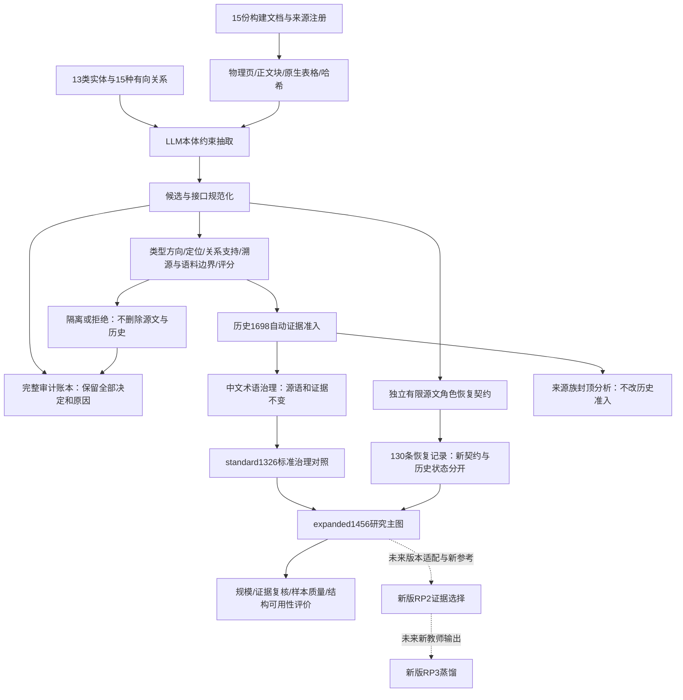
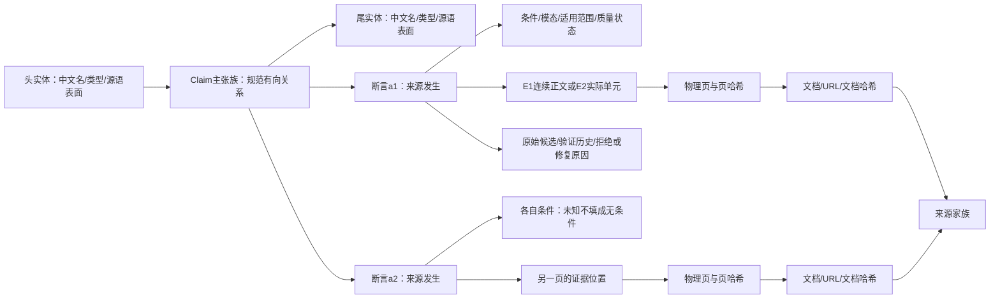
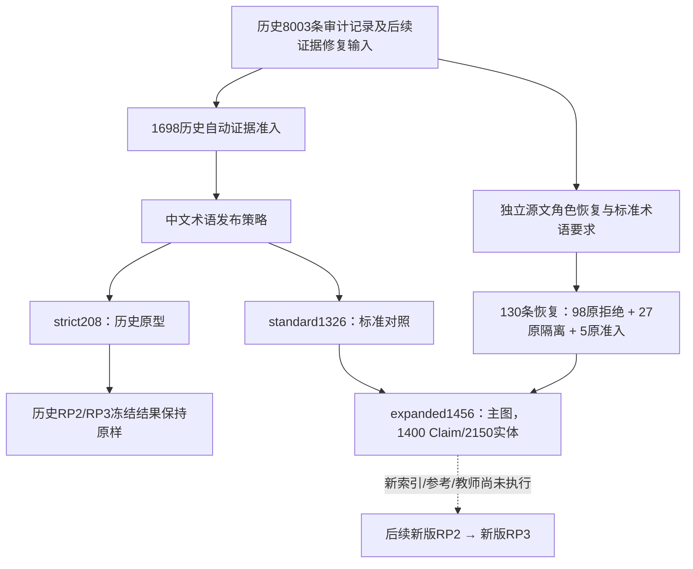
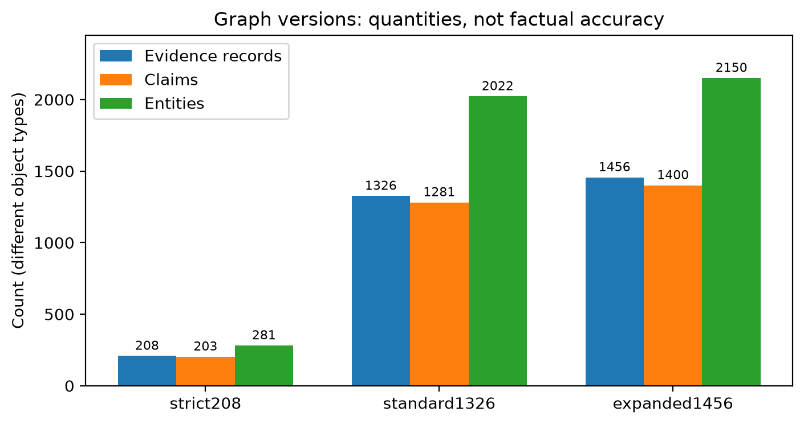
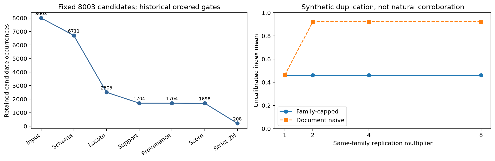

# 第3章 面向船舶机舱泵系故障诊断的知识图谱构建与质量治理方法

## 3.1 研究问题与总体框架

船舶机舱泵系承担冷却、压载、舱底排水及介质输送等任务。围绕这些设备形成的知识分散在船级社指南、厂商使用手册、故障排查表和维护程序中。同一类振动、温升或流量变化可能对应不同故障，判断其意义需要结合设备部位、运行工况、检查方法及维修措施。因此，后续故障诊断系统所需的不只是若干故障名称，而是能说明“该关联来自哪里、在什么范围内成立、具有何种证据状态”的知识基础。

直接使用大语言模型生成三元组存在三方面不足。首先，PDF中的多栏正文、合并单元格和跨行表头使阅读顺序与关系角色不一定等同于页面字符顺序，模型可能把故障、原因和措施错误配对。其次，生成的中文名称、关系方向或证据引文可能不满足既定知识模式，具有自然语言可读性并不意味着能够进入图谱。最后，若仅保留去重后的三元组，来源页、条件与重复证据容易被覆盖，同一厂商的多份手册还可能被误作彼此独立的佐证。

本章研究证据驱动的知识图谱构建与质量治理方法。其目标是在领域模式下组织泵系知识，通过页面和原生单元关联验证生成记录的可回查性，并以明确的准入、隔离、拒绝和术语发布规则形成可审计资源。方法的可靠性首先体现为身份、证据和处理过程可核验，而非预先假定所有准入知识具有专家确认的事实正确性。

总体流程如图3-1所示。首先注册多来源文档并解析物理页、正文块和表格单元；随后通过冻结的本体约束生成契约获得候选；对候选进行类型方向、证据位置、关系支持、来源及语料边界检查，并保留全部处理决定；再在源文不变的前提下开展中文术语治理。对历史未进入标准图的记录，独立采用有限原生角色证据恢复，形成最终研究主图。每条发布记录均保留回到审计账本和物理页的路径。

语料构建集合由MP001—MP007及MP015—MP022组成，共15份文档、1934个物理页。确定性排除空白、封面、目录、索引和精确重复等页面后，1889页完成全量抽取。MP008用于开发，MP009—MP013保留为外部评价资产，MP014因属于海上电潜泵信号数据集而不进入文档主图。构建边界不会因为某类知识不足而从开发或外部集合补齐。

本章最终采用expanded1456作为研究主图谱，包含1456条记录、1400项实际Claim和2150个实体；standard1326为标准治理对照，strict208为历史原型与后续早期实验的冻结来源。研究主线统一为本章构建expanded1456、后续RP2基于其组织和选择诊断证据、RP3基于新版RP2教师输出进行蒸馏。本次成果整理不改变早期strict208上的实验事实，不能将其指标直接标作新图结果。

**图3-1 证据驱动构建与质量治理总体框架**



## 3.2 船舶泵系故障知识模式设计

### 3.2.1 概念层设计

领域模式需要区分设备对象、故障形成、可观测量和干预行为。设备与部件说明故障发生的位置；原因、工况和机理说明故障形成条件；故障模式、症状和信号特征说明问题及其观测；检查方法和检查动作支持核验，维护动作支持干预；标准和风险表达规范依据及不利后果。若把这些概念都当作无类型实体，模型生成的“部件导致措施”或“检查动作引起故障”等关联即使文字上共现，也难以满足诊断用途。

表3-1列出本章采用的13类实体及其组织作用。

| 类型 | 定义及诊断作用 |
| --- | --- |
| Equipment | 泵、泵组、驱动装置等明确设备，提供系统对象 |
| Component | 泵及相连吸排、密封、润滑、驱动、阀管系统中的物理部件 |
| FaultMode | 可观察或可诊断的故障状态，作为诊断证据组织中心 |
| FailureMechanism | 导致退化或失效的物理过程，连接原因与故障发展 |
| Symptom | 噪声、泄漏、温升等定性表现 |
| SignalFeature | 测量或计算得到的诊断特征，与定性表现分开 |
| Cause | 明确陈述的起因，不把单纯部件名称当作原因 |
| OperatingCondition | 负载、压力、温度、流量、速度、介质或环境条件 |
| InspectionMethod | 具有名称的诊断或检查方法 |
| InspectionAction | 具体核查、测量或验证动作 |
| MaintenanceAction | 修理、调整、清洁、更换或预防性维护动作 |
| Standard | 标准、规则、指南、技术要求或验收依据 |
| Risk | 明确的不利后果或风险状态 |

该分类强调角色，不意味着每个词天然只有一个类型。例如“高温”在不同文本中可能表示运行工况、观测症状或不利后果，应由源文所述关系确定；不能为了满足类型约束而把任意状态改标为Component，或把普通运行操作改标为维护动作。类型词表合法与语义类型正确是不同层次的要求。

### 3.2.2 关系层与规范方向

关系集合包含15种类型。表3-2按功能说明其意义；完整Domain/Range枚举以本章配套Schema表为准。

| 关系 | 规范语义及端点约束 |
| --- | --- |
| contains | 设备或部件包含物理部件 |
| located_in | 部件位于设备或部件内 |
| occurs_at | 故障/机理发生于设备或部件 |
| causes | 原因、机理、工况或故障导致机理、故障、现象、特征或风险 |
| indicates | 症状/信号指示原因、机理、故障或风险 |
| manifests_as | 故障/机理表现为症状或信号 |
| evolves_to | 故障/机理演化为故障、机理或风险 |
| diagnosed_by | 诊断目标对应检查方法/动作 |
| inspected_by | 设备、部件或受检诊断对象对应检查方法/动作 |
| mitigated_by | 原因、机理、故障或风险对应纠正维护动作 |
| prevented_by | 明确不利事件对应预防动作 |
| maintained_by | 设备/部件对应维护动作 |
| operates_under | 设备/部件对应运行工况 |
| increases_risk_of | 原因、机理、故障或工况增加风险 |
| specified_by | 语义实体由标准或技术要求规定 |


完整Domain/Range约束（表3-2补充；由实际Schema转录）：

| 关系 | Domain | Range |
| --- | --- | --- |
| contains | Equipment, Component | Component |
| located_in | Component | Equipment, Component |
| occurs_at | FaultMode, FailureMechanism | Equipment, Component |
| causes | Cause, FailureMechanism, OperatingCondition, FaultMode | FailureMechanism, FaultMode, Symptom, SignalFeature, Risk |
| indicates | Symptom, SignalFeature | Cause, FailureMechanism, FaultMode, Risk |
| manifests_as | FaultMode, FailureMechanism | Symptom, SignalFeature |
| evolves_to | FaultMode, FailureMechanism | FaultMode, FailureMechanism, Risk |
| diagnosed_by | Cause, FailureMechanism, FaultMode, Symptom, SignalFeature, Risk | InspectionMethod, InspectionAction |
| inspected_by | Equipment, Component, Cause, FailureMechanism, FaultMode | InspectionMethod, InspectionAction |
| mitigated_by | Cause, FailureMechanism, FaultMode, Risk | MaintenanceAction |
| prevented_by | Cause, FailureMechanism, FaultMode, OperatingCondition, Risk | MaintenanceAction |
| maintained_by | Equipment, Component | MaintenanceAction |
| operates_under | Equipment, Component | OperatingCondition |
| increases_risk_of | Cause, FailureMechanism, FaultMode, OperatingCondition | Risk |
| specified_by | Equipment, Component, FaultMode, FailureMechanism, Symptom, SignalFeature, Cause, OperatingCondition, InspectionMethod, InspectionAction, MaintenanceAction, Risk | Standard |

令实体类型函数为τ，关系r的允许头、尾类型集合分别为D(r)、R(r)。一个三元组的结构合法条件为

\[
I_{type}(h,r,t)=\mathbf 1[r\in\mathcal R]
\mathbf 1[\tau(h)\in D(r)]\mathbf 1[\tau(t)\in R(r)]. \tag{3-1}
\]

式（3-1）可直接对应`validate_relation_type`中的允许类型查询。它不包含语义蕴含判断。例如，故障表中故障和原因在同一行，并不能证明故障导致原因；即使两端类型都在`causes`的允许范围，也仍需源文方向证据。

### 3.2.3 面向诊断的知识组织

诊断证据组织主要围绕四类问题：故障有何表现、由哪些原因或机理引起、如何检查、有哪些维护措施。症状与信号可沿`indicates`指向故障，故障可沿`manifests_as`关联表现；原因与机理以规范方向接入故障；检查和维护关系则形成单角色证据集合。设备层级、工况和标准对这些集合进一步限定。

这种模式允许多种可能解释并存，不强制一个现象只对应一个故障，也不强制一个故障只对应一项措施。图中存在一条检查路径不表示检查能唯一确诊；多条措施也不自动构成按顺序执行的完整维护程序。因而，模式应服务于后续证据选择，而不将知识边直接等同于完整诊断决策。

## 3.3 基于大语言模型的本体约束知识抽取

### 3.3.1 多来源文档与原生证据单元

文档注册保存厂商或出版机构、来源URL、来源族、文档划分、泵型和适用范围。页面解析保留文档哈希、物理页、页文本哈希、印刷页标签、正文块及表格。每个表格单元保存表、行、行组和列标识、列名与角色、原文及bbox。正文块则保留原文、阅读顺序和坐标。

原生单元的意义在于将表格关系与真实位置相连，而不是仅把表格压平成一段无结构文字。故障表中的故障、原因和措施需要保持同行或经验证的合并行组关系。多栏正文也不应把左栏末句与右栏首句拼成一个连续证据跨度。解析结构仍可能错误，因此后续验证既要检查ID存在，也要检查位置和上下文是否支持声明的关联。

### 3.3.2 生成模型与输入输出契约

全语料构建使用阿里云百炼DashScope别名`qwen3.7-max`，原论文记录主要生成及核验发生于2026年7月26—27日。固定20页提示对照另有2026年8月2日的运行摘要。API响应保留别名而非可确认的日期化后端权重版本，因此不追补不可知快照。后续本地Qwen2.5-7B与27B交叉评价属于局限性研究，不是原全语料生成过程。

输入由文档元数据、解析表格和本页文本构成。模型输出源语两端、中文规范名候选、实体类型、关系类型、原文证据、证据模式及单元ID，并声明证据角色等元数据。类型和关系使用固定机器码，源语字段要求保留原文，中文名称独立存储。E1使用连续引文，E2引用真实表格单元；不得用中文译名替代原文定位，也不得为了满足Schema创造本页没有的设备或动作。

抽取接口先检查字段完整性、合法词表、中文名形式及证据模式。失败提议保留原因，不删除整个页面的处理历史。8071条原始提议中64条未通过该接口，留下8007条缓存候选。后续审计记录为8003条，但经历了修复、规范化与ID变化，不能只用净差4解释全部记录处理过程。

主候选须满足图谱契约。不能表达或不确定的信息可在声明了辅助/未决输出的后续实验中保留，但原全语料生成并没有完成一个统一辅助知识库。论文不能把后续开发协议倒写成早期构图已有的全部能力。

### 3.3.3 本体约束的作用与局限

本体约束同时作用于提示设计和生成后检查。提示要求模型选择已有关系并保持方向；检查器则依据Domain/Range作确定性判断。两者作用不同：提示能够引导生成，但并不能保证模型实际服从；检查器可以发现非法输出，但不能把缺失的正确候选自动补入集合。

后续复杂语义实验中，仍有大量未遵守词表和类型组合的输出，说明“提供Schema文本”不能当成硬约束解码成功。其结果也不能直接证明需要专门复杂绑定算法。抽取方法的评价必须同时报告原始提议、规范候选和最终准入，不以删除困难候选后的比例代替完整产出。

## 3.4 主张—证据—来源联合表示方法

### 3.4.1 主张与证据发生的分离

令规范化主张族为

\[
c=(h,r,t). \tag{3-2}
\]

相同规范两端和关系可以在不同文档页出现。为避免语义去重覆盖来源，定义页面级证据断言

\[
a=\langle c,e,p,g,\kappa\rangle,\quad \pi_C(a)=c, \tag{3-3}
\]

其中e为原文及可用的位置，p为文档、物理页、URL、来源族和哈希，g为证据等级、关系支持方式、分数及处理状态，κ表示实际保存的条件、模态或范围信息。κ未显式结构化时，应标为未知，不能解释成无条件。

图3-2给出实体、Claim、断言与来源单元的关联。同一Claim可以关联多条断言；同一页面出现的新证据不会因Claim相同而被覆盖。历史固定候选实验显示，扁平化会覆盖48条额外来源断言，涉及30项多证据Claim，说明单独保存支持发生具有实际作用。

在主图中，1400项Claim是证据关联的主张族，条件与模态位于断言。因此，1400不是完全语义消歧后、无条件成立的工程事实数。构建摘要的1414个上下文组合属于另一计数口径，不能替代实际`claims.jsonl`中的1400项对象。

**图3-2 主张—证据断言—来源模型**



### 3.4.2 正文和表格证据

E1要求两端和关系证据能够在一个连续正文跨度内定位。E2要求相关原生单元构成同行或经验证的合并行组，并保留单元ID及实际位置。E3涉及重建或跨句整合，可保留审计，但不按E1/E2自动准入。对于表格，端点在同一页并不是充分条件；多项原因与措施共存的大单元还需要正确子项配对。

位置表示须遵守原数据实际提供的信息。历史strict208紧凑记忆包含145条具有连续偏移的E1记录和63条连续偏移为空的E2记录；其底层来源记录还保留可核对的表格单元bbox。不能把“底层存在单元坐标”写成“全部紧凑记忆都保存完整bbox”，更不能给E2补造连续页偏移。

文档和页面哈希用于检查内容版本身份；坐标、偏移和单元ID用于回查源文。这些机制增加可核验性，但哈希匹配或引文存在本身并不证明关系语义正确。源文有“可能”或“仅适用于”时，完整引用仍需要下游阅读或结构化处理，不能只根据裸边作无条件推断。

### 3.4.3 稳定身份与版本链接

历史ID根据规范化实体、关系及证据身份生成；源文、页面和证据单元参与证据身份。中文发布可能重建语义ID，所以跨版本不能只比较ID字符串。expanded使用EXE、EXC和EXA命名空间；1326条复用记录保留旧根级ID，同时附加统一的`expanded_*`字段，新增130条根级ID才直接采用新命名空间。

本章用记录父链接和精确来源键追踪版本：复用记录按文档、页、源文两端、关系和证据在扩图输入中唯一对应；恢复记录按明确父ID对应。实际核对1326条基线原字段保持不变，1456条均有父来源可查。身份稳定性表示在同一声明规则下可重复识别对象，不意味着所有版本天然共用一个不可变化的ID。

### 3.4.4 与已有来源表示的关系

主张及来源分离已有成熟研究基础。PROV-O提供来源及派生表达框架，nanopublication也分开断言与来源信息。本研究不提出新的来源标准，而将上述思想用于泵系物理页、表格证据和中文发布的执行契约。当前实现主要采用JSONL及GraphML，不宣称已完成PROV-O或RDF标准互操作。相应贡献在于领域数据结构和可执行流程，而非首次提出语句级溯源。

## 3.5 证据约束下的知识质量治理

### 3.5.1 多阶段校验及状态保留

质量治理首先检查关系类型和方向。确定性的方向规范化只对已经声明的类型模式执行，并记录修改；不把类型上唯一的翻转当作源文语义充分证据。随后检查E1连续引文或E2结构，并判断关系是否得到显式短语或表格角色支持。

对于规则未能确定的关系，原构建流程使用同一模型的支持与拒绝导向提示进行自动核验，要求两次结果满足声明的置信及可定位条件。1698条历史准入中，784条依据显式短语、98条依据表格角色、816条依据同模型双提示一致性。最后一种可能具有相关误差，不能写成独立模型交叉验证或专家确认。

硬失败、未决屏障和评分阈值共同决定状态。结构、类型、定位或明确不支持会触发拒绝；E3、语义未定、推断边或外部测试记录不能自动进入主应用图，可保留隔离及原因。构建文档白名单、来源与哈希完整性由构建脚本、Schema和验收过程共同落实，不允许用开发或外部文档补充主图。

### 3.5.2 启发式评分与准入条件

令α为截断至[0,1]的模型自报分数，证据等级权重为

\[
w_E(E1)=1,\quad w_E(E2)=0.95,\quad w_E(E3)=0.75,
\]

关系支持权重为1、0.75和0，分别对应支持、未定和不支持。准入函数实际采用三位中间舍入：

\[
q^{policy}=\operatorname{round}_3\left(\operatorname{round}_3[\alpha w_E(l)]w_R(\eta)\right). \tag{3-4}
\]

来源等级单独记录和检查，不乘入该关系支持分数。高权威来源不能补偿引文不支持。q是工程启发式，不是正确概率，也没有通过专家事实标签拟合为最优阈值。

将多阶段必要条件归纳为

\[
H(a)=I_{str}I_{dir}I_{loc}I_{sup}I_{prov}I_{build}I_{noninf}I_{q\ge0.8}. \tag{3-5}
\]

式（3-5）表示所有条件均满足，不能用高分抵消硬失败。无硬失败和自动发布屏障且q达到0.8时准入；候选阈值0.6及具体未定状态决定是否隔离，否则拒绝。它是程序判定的形式化说明，不是新训练目标、学习式打分器或联合优化算法。

算法3-1概括历史构建与标准发布流程。

```text
算法3-1 证据约束候选治理
输入：固定候选、原生页面、领域Schema、来源注册、术语配置
输出：完整审计账本与标准中文图
for 每条候选 a:
    保存原载荷；执行声明过的字段与方向规范化
    检查类型对；定位E1或对齐E2；记录E3屏障
    读取规则支持或已保存的同模型双提示支持结果
    应用硬失败、语料/来源边界和启发式阈值
    保存准入/隔离/拒绝及全部原因，不覆写历史来源
    为规范主张及本次页面支持分别生成关联对象
    若证据准入且中文术语规则满足：发布至标准图
return 审计账本、主张、断言、实体及来源链接
```

### 3.5.3 来源家族封顶佐证

同一厂商或出版机构的不同文档可能重用内容，简单文档计数会高估来源多样性。本研究以来源族作为内容依赖的工程代理。对Claim c和来源族f，仅保留该族最高证据评分：

\[
s_f(c)=\max_{a\in A_f(c)}q_a. \tag{3-6}
\]

按族评分降序排列，并以冻结预算B计算补零均值：

\[
S_{fam}^{(B)}(c)=\frac1B\sum_{j=1}^{\min(B,|F_c|)}s_{(j)}(c),\quad B=2. \tag{3-7}
\]

聚合脚本中的q直接对乘积保留六位小数，与准入函数的三位中间舍入区别记录。缺失来源族位置补零，单族Claim在B=2下得分不超过0.5。这表示缺少第二族佐证，不表示其事实正确概率小于0.5。

```text
算法3-2 来源家族封顶聚合
输入：符合历史过滤条件的断言，预算B
按精确Claim ID分组
for 每个Claim:
    按来源族分组，每族取最高q及稳定排序下的代表断言
    降序排列族分数，取前B项；缺失位置补0
    指数 = 分数之和 / B
    输出族数、文档数、原断言链接及指数
不修改原准入标签
```

对保持来源族和q不变的复制，族集合及最大值均不变，故式（3-7）不变。这是max运算的已有幂等性质，本研究的压力实验检验工程实现。新证据若提高族内最高q，指数仍可能上升，因此不把该性质扩大成任意同族新增都不改变分数。来源族也不是统计独立性的证明。

### 3.5.4 自动治理边界

程序校验保证的是声明条件可重复执行。它不能保证手册本身完全正确，也不能保证引文中的每个例外、型号和时序都已经结构化。原位置复核与故障注入主要检验地址、结构和来源契约；AI源文样本审查则反映另一类语义风险。两类结果应并列报告，不用其中一类替代另一类。

## 3.6 多语言术语规范化与分层图谱发布

### 3.6.1 源语保留与中文规范化

多语言手册可能以不同表述指代同一部件或动作。构图时保留原文表面、源语言、原文证据和来源身份，中文规范名作为应用显示与语义身份候选独立维护。这样既可以用统一中文接口检索，也可以回到外文源文检查，不因翻译而重写证据。

术语治理优先复用已有词典和已保存的双提示术语，后续本地治理检查同类型名称冲突、中文完整性、置信阈值及保护字符串。型号、单位、API、ISO、NPSH等不能在规范化时丢失。无法确定的名称保留在未发布/未决集合，不以临时翻译绕过门槛。该过程是局部一致性治理，并未完成所有名称的独立专家翻译核验。

### 3.6.2 标准治理对照与有限恢复

在1698条历史证据决策固定时，严格历史层保留208条，标准0.90术语层保留1326条。该变化主要反映中文发布损失的减少，不是重新抽取，也不是关系事实准确率提高。

随后，独立扩图流程在既有候选上寻找唯一原生定位和明确表格/正文角色，结合类型约束及相同标准术语阈值恢复130条。87条来自原生表格角色，43条来自明确正文角色。已有模型明确否决的记录不被此次恢复覆盖；但未重新运行原同模型双提示核验，因此新契约与原1698条准入契约不同。

扩展过程可记为

\[
G_{exp}=G_{std}\cup R, \tag{3-8}
\]

其中R为通过独立有限角色契约并满足术语要求的恢复记录。式（3-8）保证旧图记录保留和规模单调增加，不能推出事实质量或条件完整性单调提高。

```text
算法3-3 标准图的证据保留式扩展
输入：standard1326、8003条既有恢复输入及原生页面
初始化输出为标准图全部记录的副本
for 未被标准图复用的候选:
    若不在本次适用范围或存在已声明模型否决：保留原因并跳过
    尝试唯一表头/行几何角色或有限明确正文角色证明
    若无唯一证明：保留未恢复状态
    若类型或标准术语不合格：保留阻断原因
    若同一关系同页重复：不重复新增
    否则保留原验证历史，增加新原生证据及恢复说明
生成新EXE/EXC/EXA链接并封存图文件
按既定抽样读取源页评估，发现问题不删除已冻结样本
```

**图3-3 版本谱系与恢复来源**



### 3.6.3 最终研究主图与质量边界

expanded1456复用1326条标准记录，另有130条恢复记录，其原决策分别为98拒绝、27隔离和5条历史准入但未术语发布。故1456不能写成1698的直接子集。主图有1400项Claim、2150个实体，覆盖15份文档和505个有记录物理页；对照图相应为1281、2022及490页。

新增130条带有显式条件来源及模态，1326条复用断言在新字段中仍为null或`legacy_unspecified`，也没有统一显式极性字段。未知不等于无条件。图适合研究检索和逐证据展示，不能仅凭裸边当作无条件维护指令。

质量抽查发现的角色和条件缺陷与图文件一起保留，包括禁止无液运行被正向表示、把修复后果的措施接到诱因、对中状态类型不当及型号/章节条件缺失。将expanded1456作为最终研究主图，是统一研究对象和版本策略，而不是宣布这些问题已经消失。

## 3.7 实验设置与结果分析

### 3.7.1 实验设置与指标

实验分为规模及版本核数、真实API提示对照、固定候选消融、来源族压力、结构与来源复核、CQ结构路径和扩展样本质量。模型原始提议、规范候选、自动证据准入、中文发布及源文AI评价分别报告，不能共享一个“准确率”名称。

原全语料及20页API使用`qwen3.7-max`别名，固定20页为分层证据丰富样本。后续复杂语义研究使用本地7B和另一27B，仅进入局限性分析。所有关键结果保留配置、输入路径和哈希；本次成果整合只读取既有数据，没有重新调用模型或训练。

### 3.7.2 构图规模与治理保留

表3-3给出主要阶段规模。

| 阶段 | 记录/提议 | Claim | 实体 |
| --- | ---: | ---: | ---: |
| 原始模型提议 | 8071 | — | — |
| 接口保留缓存 | 8007 | 非正式发布口径 | 非正式发布口径 |
| 原审计图 | 8003 | 7651 | 9149 |
| 历史自动证据准入 | 1698 | 1650 | 2613 |
| 历史strict208 | 208 | 203 | 281 |
| standard1326对照 | 1326 | 1281 | 2022 |
| expanded1456主图 | 1456 | 1400 | 2150 |

原8003条分为1698准入、881隔离和5424拒绝。21.22%是该契约准入比例，不能据此直接判断模型事实准确率为21.22%。主图相对标准图增加130条记录、119项Claim、128个实体和15个有记录页，来源文档没有增加。新增关系主要为67条causes、30条maintained_by、15条mitigated_by、10条diagnosed_by及8条inspected_by，完整分布见配套表。规模增长证明旧候选中存在可恢复资源，但未证明整图事实质量提高。

表3-3a进一步区分三版已发布实体的类型构成。这里计数对象是实体节点，不能与候选两端类型的出现次数混用。

| 类别 | strict208 | standard1326 | expanded1456 |
| --- | ---: | ---: | ---: |
| Cause | 63 | 175 | 219 |
| Component | 24 | 348 | 363 |
| Equipment | 4 | 121 | 121 |
| FailureMechanism | 3 | 25 | 32 |
| FaultMode | 62 | 239 | 244 |
| InspectionAction | 21 | 236 | 252 |
| InspectionMethod | 4 | 117 | 117 |
| MaintenanceAction | 45 | 471 | 503 |
| OperatingCondition | 11 | 61 | 62 |
| Risk | 2 | 18 | 19 |
| SignalFeature | 0 | 45 | 47 |
| Standard | 1 | 50 | 50 |
| Symptom | 41 | 116 | 121 |
| 合计 | 281 | 2022 | 2150 |

完整关系、来源文档和来源族记录分布列入本章配套实验附表。主图的记录来源覆盖15份文档、10个来源家族；这不等于每项Claim都获得多个独立来源，精确Claim的自然跨族支持仍需按断言分别计算。



### 3.7.3 本体与抽取契约对照

表3-4复用同一20页真实API实验。五组的原始提议/规范候选/严格证据准入分别为：B0为162/0/0，B1为312/184/50，B2为226/97/31，B3为254/120/32，完整契约为367/367/148。

| 表3-4 配置 | 原始提议 | 规范候选 | 自动证据准入 | 准入/原始提议 | 请求秒/页 |
| --- | ---: | ---: | ---: | ---: | ---: |
| API20-B0 | 162 | 0 | 0 | 0.00% | 22.5 |
| API20-B1 | 312 | 184 | 50 | 16.03% | 40.9 |
| API20-B2 | 226 | 97 | 31 | 13.72% | 32.5 |
| API20-B3 | 254 | 120 | 32 | 12.60% | 35.9 |
| API20完整契约 | 367 | 367 | 148 | 40.33% | 53.9 |

完整契约的准入/原始提议为40.33%，产出是数量最强基线B1的2.96倍；每保存请求分钟的准入为8.23条，高于B1的3.67条。但单页请求延迟也由B1约40.9秒升至完整契约约53.9秒。该实验未统一候选和输出token上限，因此结果表示当前配置的结构合规产出和成本，不是等预算事实准确率优势。

页簇bootstrap显示，相对B1，准入/原始提议差的95%区间不含0，而准入/规范候选差的区间包含0。不能把所有指标都解释为显著改善。B0未形成符合本接口的规范候选，也不能据此说其全部自然语言命题错误。这一对照表明生成契约影响可执行输出，尚不等于语义事实质量实验。

### 3.7.4 固定候选消融

在同一8003条审计候选上，顺序加入Schema保留6711条，再加入E1/E2定位保留2505条，关系支持后1704条，分数阈值后1698条，历史严格中文发布后208条。相应顺序减少1292、4206、801、6及1490条。溯源/划分在该构建切片上减少0条，因为输入本已满足这些条件，不说明该组件无用。

| 表3-5 顺序门控 | 输入 | 输出 | 本阶段减少 |
| --- | ---: | ---: | ---: |
| Schema/Domain/Range | 8003 | 6711 | 1292 |
| E1/E2定位 | 6711 | 2505 | 4206 |
| 关系支持 | 2505 | 1704 | 801 |
| 溯源与划分 | 1704 | 1704 | 0 |
| 启发式评分 | 1704 | 1698 | 6 |
| 历史严格术语发布 | 1698 | 208 | 1490 |

证据定位阶段减少数量最多，体现可追溯约束对生成记录的限制；但定位失败可能源自引文或解析地址问题，不能一概视为错误事实。最后1490条损失主要属于严格术语发布限制，标准治理已恢复其中1118条。固定顺序下的边际数量依赖前序集合，不是各模块独立因果效应，也不是全部语义错误类别的互斥分布。

补充模块实验显示，扁平化主张与证据会覆盖额外来源断言；E3自动发布和取消CQ会分别隐去重建证据边界与结构功能缺口。因此，本方法的价值不仅在过滤比例，也在保存解释和暴露未覆盖部分。

### 3.7.5 证据及来源一致性

1698条历史准入全部通过既有重新定位、端点和来源子检查；881条隔离仍可定位证据及端点，其中330条E3不满足自动发布所需的列出子检查。5424条拒绝中，3947条可定位证据、2647条可定位两端、1707条通过列出子检查。后者表明位置合规并不充分决定准入，关系支持及其他条件仍可能阻断。

| 表3-6 原决策 | 记录 | 证据定位通过 | 两端定位通过 | 列出子检查全通过 |
| --- | ---: | ---: | ---: | ---: |
| 准入 | 1698 | 1698 | 1698 | 1698 |
| 隔离 | 881 | 881 | 881 | 551 |
| 拒绝 | 5424 | 3947 | 2647 | 1707 |

10类受控字段破坏共13729例均触发至少一个检查，包括身份/来源、页面/证据、端点类型和表格位置破坏。这证明程序能响应已编码违反，不证明对未知语义错误的检测率为100%。旧图36项自定义检查中有33项pass、2项info和1项非阻断warning/fail，发布阻断数为0，不能改写为36项全部通过。

expanded验收另检查了31个冻结文件、1326条基线原字段、130条新增来源、507个原生位置回读、460个上下文单元及80个固定样本。验收支持文件和链接一致性，不代替条件语义审查。

### 3.7.6 来源族治理

在1698条断言、1650项历史精确Claim上，1/2/4/8倍同族复制对应1698/3396/6792/13584条输入，来源族封顶指数均值均为0.461058，最大变化为0。文档累加均值由0.461877升至0.922116后饱和，达到0.8阈值的Claim由3项增至1650项。

| 表3-7 复制倍数 | 断言 | 族封顶均值 | 文档累加均值 | 文档指数≥0.8 |
| --- | ---: | ---: | ---: | ---: |
| 1 | 1698 | 0.461058 | 0.461877 | 3 |
| 2 | 3396 | 0.461058 | 0.922116 | 1650 |
| 4 | 6792 | 0.461058 | 0.922116 | 1650 |
| 8 | 13584 | 0.461058 | 0.922116 | 1650 |

结果说明新文档ID若仅代表同族复制，文档数会产生明显放大，来源族封顶则保持实现不变性。然而自然数据中只有3项多文档Claim，均为单一来源族，没有精确同一Claim获得至少两个族支持。故实验不能证明真实跨来源互证有效，也不能将指数当正确概率；族标签还依赖注册和内容身份边界。



### 3.7.7 图谱应用结构覆盖

40项CQ由10类已知故障与症状、原因/机理、检查、维护四角色组成。历史strict208覆盖34/40，四角色分别为7/10、10/10、7/10和10/10。standard1326同样覆盖34/40，但平均答案数从5.075增至6.400，平均证据数从6.150增至7.700，平均文档/来源族从2.700/2.350增至3.075/2.600。

| 表3-8 图谱 | 结构路径覆盖 | 平均答案 | 平均证据 | 平均来源族 |
| --- | --- | ---: | ---: | ---: |
| strict208 | 34/40 | 5.075 | 6.150 | 2.350 |
| standard1326 | 34/40 | 6.400 | 7.700 | 2.600 |
| expanded1456 | 未形成正式新版参考结果 | — | — | — |

这说明术语治理提高了已有路径的知识和来源密度，却没有补全缺失的路径类型。85%只能称为预定义结构路径可用率，不能称故障诊断准确率。当前expanded1456没有可直接沿用的正式新版CQ参考及路径结果，本章不把旧34/40赋给主图。后续可以保留问题文本，但须按新Claim、断言、别名和条件重新建立参考。

### 3.7.8 扩展样本质量及复杂语义局限

扩图后冻结抽取原标准40条与新增40条样本，单AI非盲源文判断的支持S/E/U分别为36/3/1及38/2/0；条件合格分别为23/13/4及26/11/3。同一新增40条的原始表示条件合格为15/22/3，恢复后有11条E→S，源文关系支持数没有提高。因此可支持的是部分证据及条件恢复的价值，不能把两组独立样本的90%和95%差异说成准确率显著提高。

| 表3-9 固定40条样本 | 源文支持S/E/U | 条件合格S/E/U |
| --- | --- | --- |
| 标准图样本 | 36/3/1 | 23/13/4 |
| 新增样本原始表示 | 38/2/0 | 15/22/3 |
| 新增样本恢复后表示 | 38/2/0 | 26/11/3 |

后续复杂语义研究在本地7B上完成168试次、210次生成调用及另一27B交叉评价。761条候选仅77条通过声明的局部规则链；规范化、类型、定位及条件问题混合。335条有效原始AI判S中306条原始Schema非法；319条AI判S被拒中，305条非法，剩余14条虽类型对合法，也不能直接认定为误拒。139个去重复核包中25个引用或格式不合格，完整原判仍保留。

| 表3-10 复杂语义研究项目 | 已存结果 | 解释边界 |
| --- | --- | --- |
| 生成及评价模型 | Qwen2.5-7B-Instruct BF16；本地27.3B Q4_K_M评价 | 后者本地别名qwen3.8:27b、实际架构qwen35；与全语料生成模型不同，均非专家 |
| 已执行规模 | 168试次、210生成调用、1153782输入输出token | 15开发页及6另选页，各组重复2次；不外推全语料 |
| 候选互斥主因 | 77准入、187规范化、427类型/方向、57位置绑定、13条件绑定 | 合计761；不同错误维度的重叠标记不能再相加 |
| 去重复核包 | 139个中114有效、25引用/格式不合格 | 后25个不是已确认语义错误，也不纳入有效AI语义评价 |
| 有效原始AI判S | 335条中306条原始Schema非法 | 原文支持判断与目标图谱任务合法性分开 |
| AI判S被拒 | 319条中305条非法、14条类型对合法 | 不将319条统称正确知识误拒；14条仍需逐项诊断 |
| 方法取舍 | 未证实独立复杂绑定算法的必要性 | 通用方法充分性也未获证明；B1的Schema提示不等于硬约束解码 |

上述结果没有证明需要新的复杂语义绑定算法。部分靶点的条件、OR或时序文字已经在旧输出中保留，另一些则根本没有生成必要动作或参数；它们不能统一归因于关系联合选择失败。Schema提示版也不是成功的硬解码对照。因而，本章将这些研究作为局限性和方法取舍，不将Prompt变化、规则组合或工程恢复包装为新的原创学习算法。

## 3.8 本章小结

本章面向船舶机舱泵系技术文档，建立13类实体和15类有向关系的知识模式，以Claim与页面证据断言分离保存多条来源，并通过证据、支持、语料边界、术语及来源族治理形成可审计知识资源。既有实验支持声明规则的执行性、中文发布规模扩展、部分条件恢复和同族复制不变性，同时揭示结构可用性、语义完整性和事实正确性不能混同。

最终研究主图expanded1456包含1456条记录、1400项Claim和2150个实体；standard1326作为治理对照，strict208保留历史复现用途。主要贡献体现为领域知识建模、证据约束的构建与治理方法、可追溯资源和多口径实证，不依赖虚构独立算法。主图仍存在条件、极性、角色及术语风险，且缺少专家事实标签，不能给出全语料事实准确率或召回率。

后续RP2应基于主图重建索引、合法路径及查询参考；RP3应复用新版RP2形成的教师输出。本次仅明确接口和版本策略，没有执行下游迁移，也不将原strict208实验结果改名为expanded1456结果。通过保持这一边界，本章为后续故障诊断证据选择和知识蒸馏提供版本明确、来源可追溯、质量状态可解释的结构化基础。

---

### 章节数据及引用说明（排版时转为学校要求格式）

实验表与原始出处见[03_EXPERIMENT_RESULTS.md](03_EXPERIMENT_RESULTS.md)及`source_manifest.json`；13/15完整类型表见[01_METHOD_SYSTEM.md](01_METHOD_SYSTEM.md)，不从本节简写表反向修改Schema。图源见[07_FIGURES_AND_TABLES.md](07_FIGURES_AND_TABLES.md)。

既有技术引用：[EDC](https://aclanthology.org/2024.emnlp-main.548/)、[PROV-O](https://www.w3.org/TR/prov-o/)、[nanopublication](https://doi.org/10.3233/ISU-2010-0613)、[ProVe](https://journals.sagepub.com/doi/10.3233/SW-233467)。它们用于定位已有抽取、来源和文本支持验证思想，不构成本章与其同数据同预算的性能对照。对应BibTeX条目与原论文一致，完整引用建议见04及`references/`。
