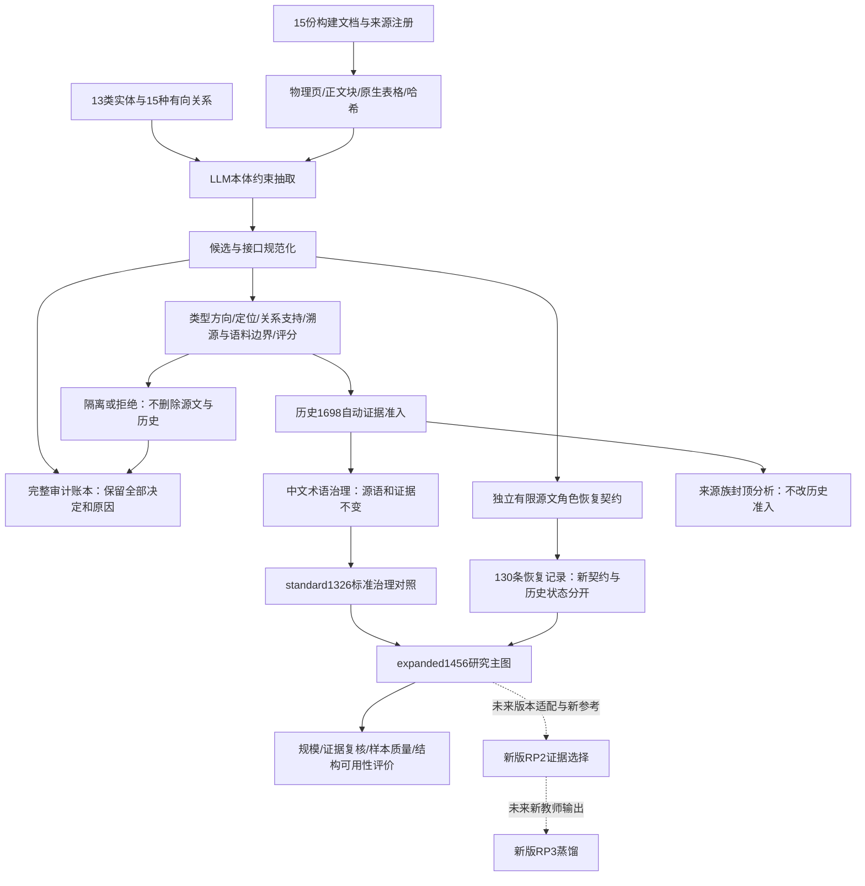
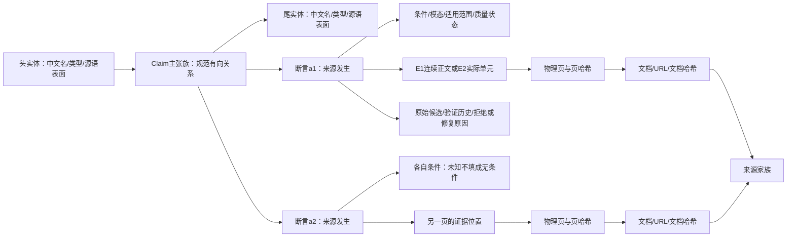
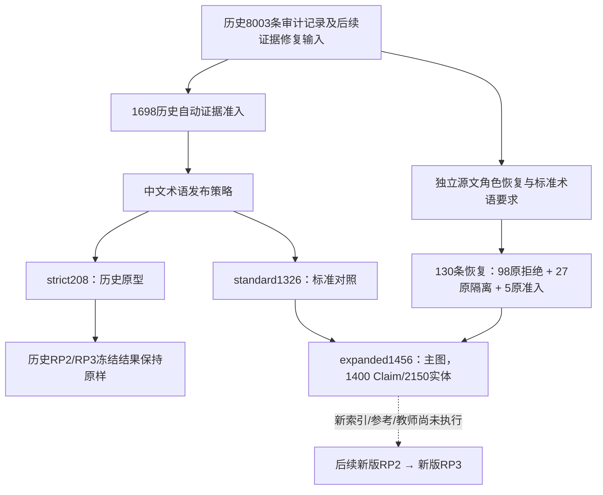
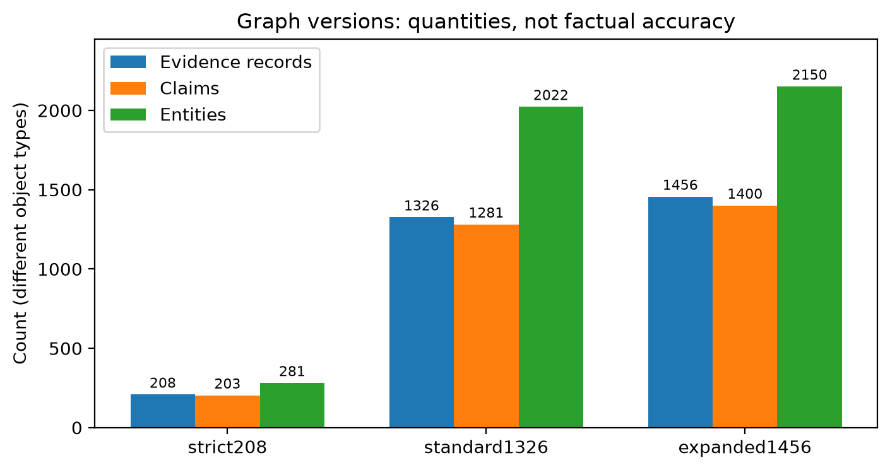
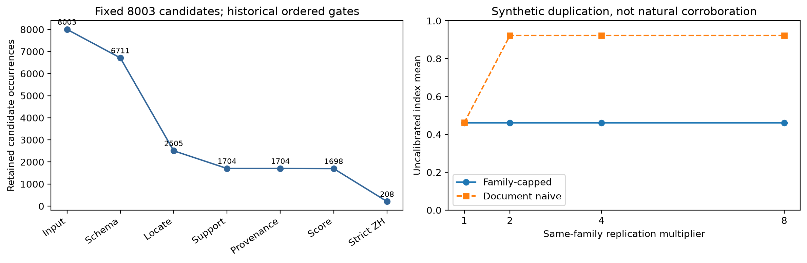

# 图表规划、现成图源与排版说明

本包提供三份可编辑Mermaid图源及两幅由已存CSV绘制的独立SVG/PNG实验图。图中虚线表示未来迁移，不表示RP2/RP3已在expanded1456上完成实验。

## 1. 方法与表示图

| 图号 | 图源 | 建议图题 | 正文说明要点 |
| --- | --- | --- | --- |
| 图3-1 | `figures/method_framework.mmd` | 证据驱动的泵系知识构建与质量治理框架 | 完整审计旁路；标准治理与独立恢复；不增加学习式优化器 |
| 图3-2 | `figures/claim_evidence_provenance.mmd` | 主张—证据断言—原生来源关联模型 | 一主张多断言；条件、模态在断言；页/单元/来源族分开 |
| 图3-3 | `figures/version_lineage.mmd` | 主图谱与历史治理版本的来源关系 | expanded不是1698直接子集；125历史未准入+5历史准入恢复 |

Mermaid源文件可在支持Mermaid的Markdown编辑器中查看后导出矢量图。未假称本机已经安装Mermaid渲染器或Visio。学校排版时可依据源文件重绘，节点含义与虚实线应保持一致。

## 2. 已绘制实验图

| 图号 | 文件 | 数据表 | 可支持解释 |
| --- | --- | --- | --- |
| 图3-4 | `figures/graph_scale.svg/.png` | `tables/graph_scale.csv` | 三版实体、Claim、证据记录的实际数量；不是准确率 |
| 图3-5 | `figures/gates_and_replication.svg/.png` | `tables/incremental_gate_ablation.csv`、`tables/source_family_replication.csv` | 固定候选顺序保留量与同族复制响应；两个不同实验面板 |

生成脚本`render_figures.py`只读取本包表格，不运行原实验。图中用英文短标签方便矢量编辑；中文图题和指标解释在正文给出。原实验已有图保留在各自目录，没有覆盖或用新图替代旧结果。

## 3. 正文实验表

| 表号 | 内容 | 来源 | 必须保留的脚注 |
| --- | --- | --- | --- |
| 3-1/3-2 | 13实体和15关系约束 | ontology两个CSV及Schema | 类型合法不保证语义类型正确 |
| 3-3 | 构建规模与版本 | graph_scale、counting_units、version_lineage | 提议/记录/Claim/实体口径不同 |
| 3-4 | 20页API策略对照 | api20_prompt_comparison | 非等token/候选预算，非事实准确率 |
| 3-5 | 固定候选顺序消融 | incremental_gate_ablation | 顺序边际作用，不是独立因果贡献 |
| 3-6 | 全量证据与来源复核 | all_candidate_audit_summary | 子检查通过不等于全部准入 |
| 3-7 | 复制1/2/4/8倍 | source_family_replication | 只证复制不变性，不证真实跨族互证 |
| 3-8 | CQ路径覆盖 | cq_version_boundaries及历史CQ | expanded未评；不是诊断准确率 |
| 3-9 | 80条扩图质量样本 | expansion_quality | 非盲单AI；不把38/40称全图准确率 |
| 3-10 | 复杂语义失败归因 | complex_binding、原受控研究报告 | 7B/27B与原qwen3.7-max不同；25包评价异常 |

## 4. 不建议制作的图

不要将1698→1456画成单一过滤漏斗；不要把GraphML的总节点数与实体数混比；不要把两个40条样本的90%/95%画成已证明准确率提升；不要给expanded画上历史34/40的CQ成绩；不要把语义AI判S和Schema合法合并成一个“正确率”柱；不要把本地7B结果标为原全量模型表现。

## 5. 可直接预览的框架图

### 图3-1 方法框架

### 图3-2 证据建模

### 图3-3 版本谱系

## 6. 已生成实验图预览

