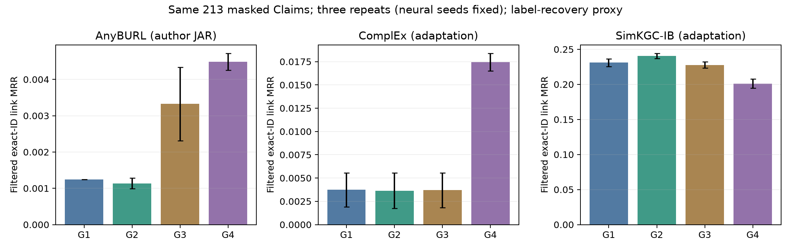
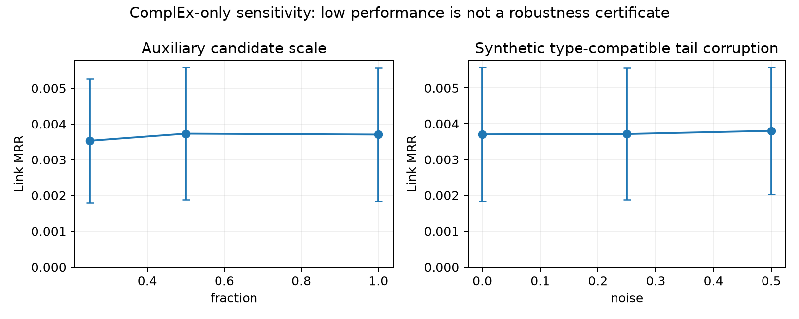
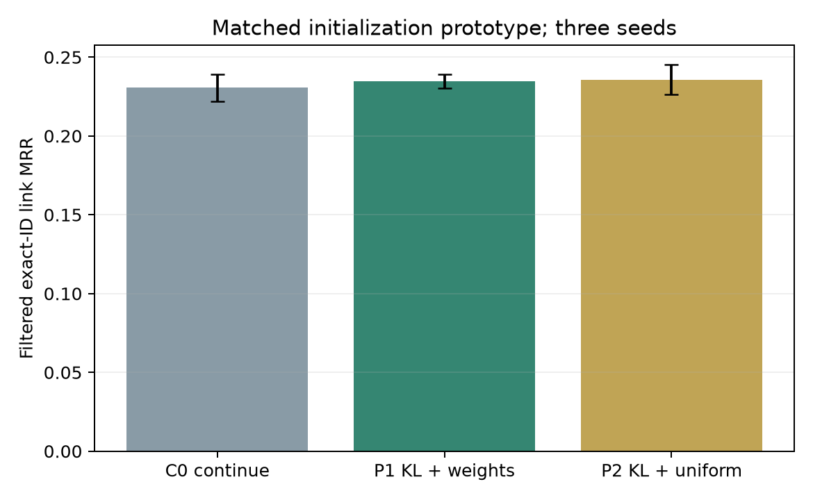

# RP1潜在关联增强与补全：已执行预实验报告

日期：2026-11-14。接续代码ce907f5；领域输入锁定833c8040058055434c7f6a9595ec524c3935755f。**本轮已实际完成数据划分、三类算法、78个训练/规则模型及对照、统一补全评价、50项留出文档标签评价、最小原型消融、26,328条推断候选及24例源文核查。** 不是上一轮22条Assertion/19条Claim/61项测试，也没有发布新图谱。

## 1. 结论与研究边界

强文本基线明显优于当前稀疏冷端点任务上的纯结构模型。保守候选使SimKGC适配版测试MRR由0.230977升至0.240410；全量分层候选降为0.227763，增加安全原文上下文后为0.201151。候选越多或加入文本并不保证改善。

依据验证集上的实际退化，实现了冻结基础模型KL锚定的最小原型。加权原型P1相对同起点继续训练C0有+0.004158 MRR，但组自助区间跨零；去掉经验置信权重的P2还略高。**存在可执行且有小幅平均改善的机制原型，尚无稳定增益或独立原创算法证据。** 不根据测试继续调参或只报最优种子。

24条定向文档核验没有确认可直接新增的完整事实：两条完整支持均已在基础图；两条超出两池的局部线索需补条件/编号/步骤。此结果既不证明整个候选空间无新事实，也不支持“已发现25,641条新知识”。正式expanded1456、RP2/RP3和现有服务器模型未被改写。

## 2. 数据、划分与泄漏控制

基础图仅expanded_v1_20261012：1456 Assertions、1400 Claims、2150 entities。三份初始候选链路保留头尾/证据/状态/原因，normalized口径8003记录。仅15份构建手册；原PDF不重新解析/抽取；MP008和外部文档不进入本实验，也没有读取其他版本图谱。

按源语/中文别名闭包、无向端点对、相同引句、共享原生单元合并遮蔽组，共1087组，最大48 Claims。散列固定划分939训练、198验证、213测试；MP022所有相关组另留50 Claims作来源文档留出。训练只见`train_base`和清理后的训练候选/文本，测试标签及原始出处留在`audit_only`，最后统一释放。

自动别名仅用于保守分组和副本阻断，不是同义真值。**最终主指标使用精确实体ID和精确基础事实过滤**；自动别名过滤仅敏感性分析。此口径在测试释放前冻结。模型选择始终使用预设的自动别名过滤验证代理，未根据测试更换检查点或口径。该验证代理与最终主口径的区别必须披露。

语义图隔离检查（不混入Claim/Evidence中间节点）：G1中666个基础实体零正边度，活跃最大连通分量仅37节点；353个不同测试端点中304个在G1训练图孤立，280个在完整基础图中本就只有1条关联边。G2/G3训练正上下文使测试孤立端点降至300/261，但后者含不确定候选，不等于事实图变可靠。见`isolated_endpoint_structure.csv`。因此纯结构方法差不能解释为其算法一般无效；当前图与保守遮蔽存在明显结构可观测性限制。

遮蔽副本控制包含：所有关系的端点对及其反向、同义源语/中文副本、同单元和引句、候选中的目标副本；G4不见目标/副本原页，不见MP022，并按所有位置的20字符shingle删除重叠候选/文本。最终清理表：

| 输入/视图 | 实际数量/处理 |
| --- | --- |
| 原始normalized候选 | 8003记录；不是8003有效融合样本 |
| 最终可追踪候选边 | 6167；含751条已是基础训练事实的上下文 |
| 额外候选 | 5416；神经模型对已基础事实去重 |
| 保守G2额外候选 | 238 |
| 6167分层 | qualified 932 / quarantine 684 / rejected 3453 / schema_invalid 1098 |
| G4安全原生单元 | 46,923；4137个目录实体有保留上下文 |
| 统一答案目录 | 2150基础实体；15关系。候选扩展目录8754实体仅作训练上下文 |

`data/summary.json`是第一遍准备统计；**最终训练以`safety_refinement_summary.json`为准**（第二遍又删724条候选边；先前6891、G2=320等不是最终训练数）。候选状态是自动证据合同标签；权重0.5/0.15/0.05/0.02是固定工程假设，不是校准事实概率。

G1训练端点覆盖定义下，213测试中warm仅1、one_cold 72、both_cold 140；验证4/55/139；文档留出0/9/41。所有方法使用相同测试目标和答案集合，**该划分主要测已知实体目录上的冷端点恢复，不能外推为一般warm KGC或新实体发现能力**。保守屏蔽会减少结构路径，不能为提高结构算法分数在测试后放松。自动闭包仍不能证明消除了所有语义转述或预训练记忆。

## 3. 实际算法及实现身份

| 算法 | 身份与实际设置 | 未完成部分 |
| --- | --- | --- |
| AnyBURL | 作者AnyBURL-23-1x JAR Learn/Apply，10/30秒规则快照、单worker、maxplus聚合；自定义分层谓词/证据单元导出及统一评分 | 不等同充分预算的论文复现；作者未暴露确定性seed，三行seed是输入/重复标识，学习随机性未被这些seed控制 |
| SimKGC-IB | 作者仓库97cc43e4的CustomBertModel/compute_logits不变；本地BGE-small中文4层BERT初始化，双塔真实反向传播，in-batch+self negatives，pre_batch=0；自定义数据与权重训练适配 | 不是原论文数据/编码器/全配置复现；非TF-IDF/LSA，也没有运行大模型生成 |
| ComplEx | 原始复数多线性打分的PyTorch适配，64维复向量、Adam、logistic采样负例、训练已知正例mask、L2；G4加冻结BGE特征投影 | 不是作者代码复现或全面调参的SOTA宣称 |
| NBFNet | 检查作者依赖；本机缺torch_scatter/torchdrug，未运行 | 不用路径统计替代，不填造结果 |

三类实现机制分别为规则归纳、文本双塔对比学习、实体关系嵌入。神经种子14112026/27/28。ComplEx最多150 epochs、验证每10轮（含第1轮）、patience40、lr.003、batch128、32负例；SimKGC最多10 epochs、patience3、batch32、lr2e-5、maxlen96。配置、逐轮历史、检查点及SHA全部保存。负采样未观察事实不是经证实的错误事实。

资源：RTX5880 Ada 48GB但初始仅约8GB空闲，保留其他服务约37.5GiB；内存125GiB；PyTorch2.6.0+cu118、transformers4.57.6；Java17隔离安装。候选和文本成本不同，不声称跨算法或G1—G4同FLOPs。

## 4. G1—G4的可比较定义

G1仅939条基础训练关系；G2加入238保守候选；G3使用全部可追踪候选并按身份区别对待；G4在G3上加安全文本。

神经G3按状态加权辅助目标；SimKGC不把1098个Schema非法上下文当对比学习正例，ComplEx把它们作为**结构一致性负例**（不是事实反例）。AnyBURL用`C关系_状态`辅助谓词，G3/G4主行包含751个基础事实对应的C谓词桥接上下文，使作者规则能够学习C→基础谓词；无桥接版本另保留消融。AnyBURL G4使用真实原生单元共现节点，神经G4用真实文本编码。**这些是同一信息增量的算法专属适配，不是逐边相同的训练图或完全相同的文本机制。** Schema非法记录仍可追溯，候选参与计算不等于事实晋级。

主指标：head/tail两任务的filtered MRR平均；Hits按平均并列rank阈值计算；关系预测枚举全部15关系。全答案2150实体，主排名不先按类型删候选，另报typed MRR。只过滤完整基础图的已知精确正例，不用不确定候选充当评测Gold。并列采用绝对容差1e-8、平均rank，并保存均匀随机打散并列的期望倒数rank。AnyBURL未推导项全零，不能按实体字母顺序将未覆盖样本算命中。

补全排名为**基础自动图标签恢复代理**；非事实准确率/诊断准确率。完整原始分数NPZ和逐查询rank/ties/首选/类型合法性均已保存。

## 5. G1—G4实际结果

213测试Claims，426个头尾查询，均值±总体种子标准差；AnyBURL为三次真实随机重复。

| 算法 | 视图 | link MRR | Hits@1 | Hits@10 | 关系MRR |
| --- | --- | --- | --- | --- | --- |
| anyburl | G1 | 0.001239 ± 0.000000 | 0.0000 | 0.0023 | 0.1291 |
| anyburl | G2 | 0.001135 ± 0.000145 | 0.0000 | 0.0016 | 0.1277 |
| anyburl | G3 | 0.003327 ± 0.001011 | 0.0008 | 0.0055 | 0.1332 |
| anyburl | G4 | 0.004484 ± 0.000230 | 0.0000 | 0.0086 | 0.1400 |
| complex | G1 | 0.003740 ± 0.001826 | 0.0008 | 0.0039 | 0.2439 |
| complex | G2 | 0.003641 ± 0.001902 | 0.0008 | 0.0031 | 0.2345 |
| complex | G3 | 0.003702 ± 0.001864 | 0.0008 | 0.0031 | 0.2449 |
| complex | G4 | 0.017435 ± 0.000935 | 0.0055 | 0.0297 | 0.2252 |
| simkgc | G1 | 0.230977 ± 0.005603 | 0.1667 | 0.3474 | 0.8031 |
| simkgc | G2 | 0.240410 ± 0.003590 | 0.1761 | 0.3466 | 0.7930 |
| simkgc | G3 | 0.227763 ± 0.004232 | 0.1612 | 0.3498 | 0.7892 |
| simkgc | G4 | 0.201151 ± 0.006674 | 0.1385 | 0.3239 | 0.7719 |

SimKGC G2的三个种子均高于各自G1，但G3不一致，G4三个种子均下降。不能把该小样本结果外推为全图新增事实收益。ComplEx G4提高，但`G3_labels`=0.017648高于G4=0.017435，说明不能把提高归因于原文证据，名称编码本身足以解释。文本混合语言、短截断及源文选择可能影响G4，本轮没有逐一归因，不断言“原文无用”。

Schema-only诊断参考link MRR=0.004815、关系MRR=0.930360；Schema+训练频次为0.030343/0.948357；未微调同编码器为0.091501/0.564402。关系类型在当前Schema中高度可由端点类型决定，**训练模型0.77—0.82的关系MRR并不优于简单类型参考，不能当独立算法突破**。这些诊断项不是冒充SimKGC或AnyBURL的基线。

AnyBURL规则目标正分支持覆盖G1/G2/G3/G4分别0.47%/0.31%/0.94%/1.72%，非恒定分数覆盖14.55%/11.03%/22.54%/28.56%。SimKGC头尾首选Schema不合法率11.11%/7.28%/10.25%/13.62%，说明候选增加既可改进也可干扰类型一致性；它不是事实错误率。完整数据见`prediction_error_and_coverage_proxies.csv`，冷端点分层见`cold_endpoint_metrics.csv`。未覆盖时的首选是固定ID打破并列，不能把其Schema错误当有依据的错误规则推断；应同时读取target_rule_support与ties。神经输出非恒定率100%也不等于有效推断覆盖100%。

## 6. 直接合并、分层与名称/文本消融

| 算法 | 条件 | link MRR |
| --- | --- | --- |
| anyburl | G3 | 0.004755 |
| anyburl | G3_bridge | 0.003327 |
| anyburl | G3_flat | 0.014086 |
| anyburl | G4 | 0.004271 |
| anyburl | G4_bridge | 0.004484 |
| complex | G3 | 0.003702 |
| complex | G3_flat | 0.005128 |
| complex | G3_flat_filtered | 0.003152 |
| complex | G3_labels | 0.017648 |
| complex | G3_uniform | 0.004575 |
| complex | G4 | 0.017435 |
| simkgc | G3 | 0.227763 |
| simkgc | G4 | 0.201151 |

AnyBURL直接合并G3_flat明显好于该次分层适配，而桥接没有一致增益；这否定“分层必优”的预设。ComplEx naive flat的基础负例过滤只认基础边，候选可能自相矛盾，因此额外保存修正对照`G3_flat_filtered`，其过滤识别合并训练正例；不隐藏旧行，也不把混杂旧行作为分层优越的证据。平铺条件在相同base-size epoch下采样合并池，会稀释基础曝光；另有`G3_uniform`在相同双流基础曝光下仅删除权重，才用于判断权重本身。

没有证据证明固定四档状态权重优于统一利用候选。不同算法对非法候选的处理不同，不能直接用跨算法差值归因某一权重设计。

## 7. 候选规模与噪声敏感性

以下为ComplEx同一G3机制、同最大训练设置的实际三种子实验。

| 保留候选比例 | 名义合成扰动概率 | link MRR |
| --- | --- | --- |
| 0.25 | 0.0 | 0.003528 ± 0.001737 |
| 0.5 | 0.0 | 0.003728 ± 0.001853 |
| 1.0 | 0.25 | 0.003712 ± 0.001842 |
| 1.0 | 0.5 | 0.003800 ± 0.001774 |

全量无扰动G3=0.003702。0.25/0.5为按种子散列采样的**候选保留概率**，不是保证精确四分之一/二分之一；实际数量在每模型config。0.25扰动实际1519/1581/1553，0.5为3118/3133/3072（6167边的预生成列表口径，神经去重后数量另见config）。替换尾端符合关系range并避开目标副本及训练已知边，OWA下仍不能保证全为假事实。原始状态权重保持，不把合成标记泄漏给训练损失。

MRR都很低、变化很小，**这是低性能/弱信号下的敏感性结果，不是算法抗噪性已证实**。本轮规模/噪声扫描只覆盖ComplEx，不声称已在SimKGC/AnyBURL全面复现。

## 8. 最小改进原型及消融

真实验证失败：第一种子G1=0.269491，G2=0.257455，G3=0.264788。测试前在`prototype_pretest_decision.json`固定“学习候选时保持可信基础响应几何”的机制。令基础训练批损失为L_base，辅助候选逐例损失为l_i，经验权重为w_i：

`L = L_base + 0.3 * mean(w_i*l_i) + λ * KL(p_frozen_G1 || p_current)`。

KL只在当前**基础训练批**query与tail分布上计算，温度用模型已有可学inverse-temperature；沿用训练正例mask，不读取测试或独立文档。各组从同种子G1最佳权重出发，统一样本生成与最大5 epochs，C0也计算相同冻结参考前向但λ=0；P1 λ=1、保留w；P2 λ=1、w=1。各组独立验证早停，实际epoch/成本可能不同，不能宣称最终更新次数必相同。

| 机制 | link MRR | 关系MRR |
| --- | --- | --- |
| anchor | 0.234734 ± 0.004306 | 0.8193 |
| anchor_uniform | 0.235656 ± 0.009514 | 0.8232 |
| continue | 0.230576 ± 0.008656 | 0.8217 |

P1−C0逐查询加权差+0.004158；按153个事实组宏平均差+0.009528，2000次组自助95%区间[-0.000426,0.019926]。P2−C0逐查询差+0.005080，组宏差+0.008090，区间[-0.002212,0.019205]。此区间只条件于当前固定拆分，不包含重新采样手册的不确定性，也不是事实风险证书。

P1第一种子反而下降（0.241237→0.238567），另两种子提高；P2三个种子提高，但区间跨零。**KL机制有小幅均值改善，稳定性未建立；分层权重没有额外贡献证据。** 选择用于推断的P2来自三种子验证均值最高0.271447，而非测试最优：其固定第一种子检查点SHA见`discovery/model_selection.json`。保留所有九次原型运行及负结果，不继续叠机制。

## 9. 留出文档恢复与真正独立证据的区别

MP022训练图、候选、原文均整体排除；50个基础自动标签仅在模型封存后评分。45个模型完成此项，不拿它调参。

| 算法 | 视图 / 原型 | 留出文档 link MRR |
| --- | --- | --- |
| anyburl | G1 / none | 0.000929 ± 0.000000 |
| anyburl | G2 / none | 0.000929 ± 0.000001 |
| anyburl | G3_bridge / none | 0.000928 ± 0.000000 |
| anyburl | G4_bridge / none | 0.000909 ± 0.000000 |
| complex | G1 / none | 0.001901 ± 0.000288 |
| complex | G2 / none | 0.001872 ± 0.000205 |
| complex | G3 / none | 0.001863 ± 0.000246 |
| complex | G4 / none | 0.033045 ± 0.006354 |
| simkgc | G1 / none | 0.594795 ± 0.012752 |
| simkgc | G2 / none | 0.606709 ± 0.018401 |
| simkgc | G3 / anchor | 0.587438 ± 0.008024 |
| simkgc | G3 / anchor_uniform | 0.591253 ± 0.014072 |
| simkgc | G3 / continue | 0.581427 ± 0.005412 |
| simkgc | G3 / none | 0.578936 ± 0.021715 |
| simkgc | G4 / none | 0.503729 ± 0.011686 |

这仍是**单本手册、已知实体目录的标签恢复**，动作名称含较丰富语义，不能说是未知设备/实体泛化；也不是50个新事实人工验证。50项均有至少一个G1冷端点。训练端点同文档留出关系未进入训练，但其中文名称是共同给定目录侧信息，预训练数据记忆未知。

## 10. E1/E2新潜在关系与文档核验

验证选择的模型对所有domain-compatible头/关系查询共8776组，每组最多输出3个range-compatible尾，得到26,328条**未校准模型推断**，不限两跳、不直接添加因果传递边。top3是提议上限，不是事实准入阈值。

| 类别 | 数量 | 含义 |
| --- | --- | --- |
| 基础图已知 | 598 | 包括保守排除的观测反向表达 |
| 初始候选已出现 | 15 | 不得称为新发现 |
| 已见端点对上的新谓词 | 74 | 可能是角色/关系错配 |
| 两池外的新端点关系组合 | 25,641 | 模型空间提议，绝非25,641项正确知识 |

已知集合对raw/audit/normalized三阶段取并集，并以自动别名保守封闭；明确观测逆向形式保守归已知，但不声称所有indicates/manifests_as、contains/located_in普遍逻辑等价。新颖性仍是有限记录比较，非全世界新事实。

固定MP022检索得到77条同页端点命中。按预定规则选24包，核验完整页面和原生单元：**S=2、C=14、E=4、U=4**。S仅指附文档范围后的完整原子支持；C为必须补局部条件/编号/时序；E是当前证据下的关系/角色不支持；U证据不足。不是新LLM裁判API；由执行本任务的AI实际阅读，非专家Gold、非独立模型、非双盲。所有判断在`AI_source_review.jsonl`并保留原文。

19/24有排除20gram重叠后的留出文档片段，1包（R19）仍有保守短串重叠标记、4包无证据。更严的“两个端点都在正训练中出现+留出无重复源文”资格为0/24；**文档留出独立性与端点独立性分开报告，不能冒充完全未见独立事实验证**。

S两条R22（维修后检查平稳运行）、R24（安装前润滑橡胶件）都是基础图已有。两池外R05/R07仅有条件性支持，缺少反向支撑/阶段或清洗步骤/型号，不能原样新增。R09把接液盘误作防止轴封泄漏；R23混淆O形圈(44)/(15)；R06混淆动作对象和安装位置；R08把收集泄漏液等同缓解泄漏本体。R10—R13无当前检索证据，不据此断言事实为假。

**当前新完整事实确认数0，正式新增0。** 已分别保存原文明示、条件支持、支持但非独立、源文不匹配和仅推断层。C层是分析带条件的线索，并未运行语义修复器自动生成新正确关系。24例定向样本不估计总体precision。详见[逐例核验](discovery/SOURCE_REVIEW.md)和[排名失败案例](analysis/FAILURE_CASES.md)。

## 11. E3已有关系增强产物

独立`enhancement/claim_overlays.jsonl`覆盖1400 Claims/1456 Assertion链接：保留稳定ID、文档物理页、原生单元/现有offset、来源家族、适用范围、原有质量原因及模型关系一致性。附既有关系对15类的排序/余弦分数及top3替代。1130/1400在所选模型中为首选关系，仅为混合train/valid/test的事后一致性统计，不是新评价成绩或事实可信概率。

原有conditions字段原样拷贝，没有凭空补齐条件、学习条件所有权或提升原有资格。训练Claim另标interpolation。此为E3可追溯表示/审计侧表，**不是已实现条件感知融合创新或正式发布版本**。

## 12. 成本、复现及运行事件

所有78个条件的参数数、最佳epoch/规则快照、训练循环时长、测试时长、GPU峰值在`runtime_costs.csv`，每模型完整配置与日志保留。神经循环时间含自身验证、不含下载/初始化/文本特征准备；SimKGC基线实测约40—94秒/次，G1峰值约1.81GiB，候选组约3.03GiB；KL原型约3.39GiB。不是端到端或边缘设备耗时。AnyBURL多数学习及初评约34秒，一次初始G1学习时长未保存，明确留空，不用恢复应用的1.28秒冒充训练。冻结特征编码metadata另记tokens和成本。

保留技术恢复记录：ComplEx首次验证少detach导致报错，修正后用r1新后缀；AnyBURL作者正常结束会System.exit(1)，只在Bye及10/30两快照齐全时识别恢复，未重学已完规则；旧top200输出保留，最终均采用覆盖整个目录的作者输出并只用验证重选快照；并行GPU训练曾OOM，原失败目录/配置完整备份后串行同种子重启，未杀服务器其他模型。Java源下载403后换官方Azul JRE，未改系统Java。以上都不作为算法失败或增益。

复现见[REPRODUCE.md](REPRODUCE.md)。逐输入对象哈希、有效数据freeze、测试释放前决策、模型/预测分数和逐轮日志构成证据链。代码和交付文件清单及原图输入未改检查见`verification/`；统计测试不代替语义真值。

## 13. 方法区别与创新性判断

详细逐项对照见[METHOD_AND_RELATED_WORK.md](METHOD_AND_RELATED_WORK.md)。MusKGC研究开放世界、多源知识和LLM生成含新实体；本轮闭合实体目录、没有调用LLM生成。NAAER已有规则/嵌入迭代与噪声筛查；本轮未复现它，不可宣称超越。UKGE、FocusE及2026规则可靠增广研究已涉及置信或边权利用；KL保留基础响应也属于既有蒸馏/抗遗忘思想。

**本轮确实实现并实测了联合利用可信基础与不确定候选的原型，但不足以据此把“双层+权重+KL”定为原创核心算法。** 当前最明确的经验结论是：冷端点下文本基线较强、额外噪声可能损害它、Schema可解释大部分关系类型代理、角色/编号/条件支持仍不能由高余弦保证。没有测试后迭代选择机制，没有将已有候选重新输出包装为发现。

## 14. 尚未完成及终止边界

未运行NBFNet、MusKGC或NAAER完整作者基线；AnyBURL为短预算适配；尚无多拆分/多独立手册/人工事实评价、无大规模独立AI裁判、无新增实体补全、无关系可信概率校准、无学习的设备/条件兼容性模块，规模/噪声仅在ComplEx扫描。G4不是全页原文检索重建任务；未开展允许目标引句的检索恢复指标，不能与本防泄漏主表混比。

本阶段交付已完成，**不提升正式图谱，不依据本次弱均值增益宣称核心算法成立**。在已有数据/预算下，不继续用测试结果叠加机制。原型负结果、源文错误和未验证预测均保留，后续若改动任务或评测需要独立版本与新的模型选择过程。
