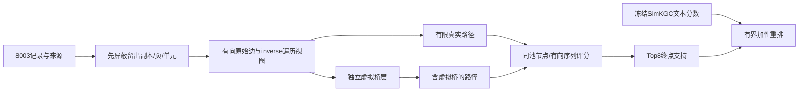

# 多路径协同补全：实际计算流程

固定2150答案目录，以相同冻结SimKGC G2双塔特征为底座。先构图和行政遮蔽，再建桥/生成路径。未确认候选既不转为监督正例，也不作为事实发布。

对查询(h,r,?)，文本分数b(t)=Q_SimKGC(h,r)^T E_SimKGC(t)。对每个可达目录终点t，取同一路径池中评分最高的至多8条不同节点/边/有向关系序列路径，定义

    a(p)=exp(clip((s(p,q)−0.65)/0.1,−10,10))
    A(t)=Σ_p a(p),    U(t)=A(t)/(1+A(t))
    f(h,r,t)=b(t)+λU(t)

无路径时U(t)=0；整查询没有目录终点路径时所有文本分数及排序严格不变。U是有界支持特征，不是事实正确概率；共享证据路径仍可能相关，因此设置Top8，未声称统计独立。原始Assertion重复不产生重复计算路径。

λ∈{0,.05,.1,.2}。每方法只选一个三种子平均验证MRR最优λ，平局取最小值；全部网格和所有种子保留。另给同一full λ=.1的消融，防止各消融独立选参造成比较误读。没有用测试选模型。

匹配raw transport_R3保留原查询端点迁移：u_i=E(b_i)−E(a_i)+E(h)，带null的softmax(s_i/.1)加权，q'=normalize(q+αΣw_i u_i)，分数q'^T E(t)。原R3的类型/角色掩码仅在查询检索阶段应用，不删除研究图的非法边；另保留不应用该硬掩码的raw_soft对照。结构距离及profile均来自相同5055边raw训练池。普通semantic kNN按.6×短边文本相似+.4×锚点相似检索，在目录终点上进行概率记忆插值。

历史R3使用另一套4660边合法索引，仅作明确标记的重放参考；不能用它与新路径池的差分声称算法增益。G1/G2使用原作者SimKGC模型/对比logits、本地BGE与采样适配，本轮复用三种子缓存，没有伪称重新训练或完整原论文复现。

评价：374个头/尾方向、334个查询key，平均处理1e-8数值并列；按989训练+187验证已知答案过滤其他真项，保留当前目标。候选答案不做强制Schema裁剪，以便报告top1类型合规。95%区间来自133个事实/来源组的2000次成对重采样；先跨种子平均RR，再按组重采样。它不校正验证选参，也不是事实准确率的置信区间。
