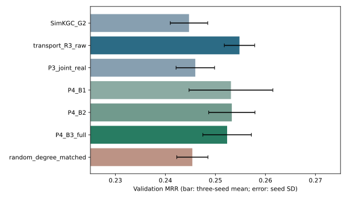
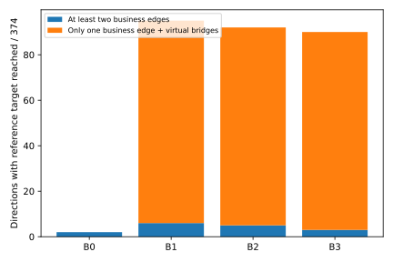

# RP1原始候选图—虚拟桥—多路径补全：实际实验结论

日期：2026-11-17。仅expanded1456、8003规范化候选及15份构建手册；本轮未重新抽取、未调用外部LLM、未写正式图谱或RP2/RP3。全部排名是内部开发验证代理指标，不是事实准确率或独立测试。

**本阶段已完成代码实现和三种子实测。raw图结构显著增强，语义桥改善部分恢复排名；完整多路径原型未优于相同候选池的transport_R3，尚不支持把有向多关系组合或多路径协同认定为有效的独立算法创新。**

## 实验范围与数据

8003记录→7583完整计算边→5279遮蔽后记录→5050raw边，合并安全基础上下文为5055边；9021全实体，固定2150答案。保留950条Schema不兼容可见记录，无旧状态准入筛选。15份构建手册，领域对象和输入哈希见`verification/domain_inputs.json`。

冻结989/187/224任务不变，主实验仅187验证Claim的374个预测方向，不生成新测试结果。三种子为16112026/27/28。复用历史作者模型适配版SimKGC G1/G2的权重和特征，路径原型新训练参数0；所有主对照在相同缓存底座与固定答案目录比较。历史缓存具有比本轮上下文更宽的训练边界，详见`GRAPH_BUILD_PROTOCOL.md`，不能声称已彻底消除近义训练副本风险。

## 实际量化结果

| method | alpha | MRR_mean | MRR_seed_sd | Hits1_mean | Hits3_mean | Hits10_mean |
| --- | --- | --- | --- | --- | --- | --- |
| SimKGC_G1 | 0.000000 | 0.239606 | 0.004556 | 0.172014 | 0.261141 | 0.361854 |
| SimKGC_G2 | 0.000000 | 0.244716 | 0.003745 | 0.178253 | 0.266488 | 0.366310 |
| transport_R3_historical | 0.200000 | 0.259757 | 0.006203 | 0.188057 | 0.286988 | 0.384135 |
| transport_R3_raw | 0.200000 | 0.254806 | 0.003041 | 0.181818 | 0.281640 | 0.380570 |
| transport_R3_raw_soft | 0.200000 | 0.252111 | 0.002307 | 0.180927 | 0.275401 | 0.378788 |
| semantic_knn_raw | 0.100000 | 0.252335 | 0.001996 | 0.182709 | 0.278966 | 0.376114 |
| P3_joint_real | 0.200000 | 0.245973 | 0.003851 | 0.179144 | 0.269162 | 0.366310 |
| P4_B1 | 0.100000 | 0.253101 | 0.008377 | 0.184492 | 0.273619 | 0.383244 |
| P4_B2 | 0.100000 | 0.253271 | 0.004623 | 0.186275 | 0.273619 | 0.376114 |
| P4_B3_full | 0.100000 | 0.252335 | 0.004850 | 0.185383 | 0.273619 | 0.376114 |
| best_single_path | 0.100000 | 0.252659 | 0.001874 | 0.186275 | 0.273619 | 0.376114 |
| real_multiedge_only | 0.000000 | 0.244716 | 0.003745 | 0.178253 | 0.266488 | 0.366310 |
| shuffle_relation_order | 0.100000 | 0.252098 | 0.004927 | 0.185383 | 0.272727 | 0.376114 |
| random_degree_matched | 0.050000 | 0.245381 | 0.003114 | 0.177362 | 0.271836 | 0.365419 |
| no_relation_fixed_scale | 0.100000 | 0.250889 | 0.002715 | 0.183601 | 0.274510 | 0.377897 |

完整原型相对同池raw-R3：ΔMRR=-0.002471，成对组重采样95%区间[-0.014217,0.007968]。区间跨0，不能宣称超过；也不把此区间当独立检验或证明二者等效。

| method | seed | MRR | Hits1 | Hits10 |
| --- | --- | --- | --- | --- |
| SimKGC_G2 | 16112026 | 0.241775 | 0.168449 | 0.387701 |
| SimKGC_G2 | 16112027 | 0.248933 | 0.184492 | 0.363636 |
| SimKGC_G2 | 16112028 | 0.243441 | 0.181818 | 0.347594 |
| transport_R3_raw | 16112026 | 0.254981 | 0.176471 | 0.385027 |
| transport_R3_raw | 16112027 | 0.257757 | 0.189840 | 0.377005 |
| transport_R3_raw | 16112028 | 0.251681 | 0.179144 | 0.379679 |
| P4_B3_full | 16112026 | 0.257270 | 0.189840 | 0.390374 |
| P4_B3_full | 16112027 | 0.252160 | 0.184492 | 0.377005 |
| P4_B3_full | 16112028 | 0.247575 | 0.181818 | 0.360963 |

种子26的full高于raw-R3，但另两种子低于它，不能只展示种子26。

## 路径是否提供真正组合

完整raw图最大组件3082实体；严格遮蔽后1820实体。全图确实增加结构，但验证目标仅1/187有真实三跳连接，0/187有真实两跳。B3把到真实目标的方向数提升到90/374，其中87只有单业务边迁移、3涉及至少两条业务边。关系顺序反转、单路径和无关系重排控制不支持稳定的组合增益；详见`MULTIHOP_PATH_ANALYSIS.md`及`ABLATION_RESULTS.csv`。

## 本阶段决策

不追加大型GNN、Transformer或小神经路径评分器训练。本轮正信号是“语义桥与原始候选上下文可改善部分文本排名”，尚未通过更强的匹配R3与顺序控制检验；没有足够证据证明扩大网络会解决瓶颈。保留完整负结果、代码和三种子，而不是选出最优种子作创新结论。

下一次算法修改若继续，应首先在**训练事实留组外**统计关系序列的选择性（同一序列对不同目标关系的区分，和类型/节点相似基线相比），并只对至少两业务边且设备/条件一致的路径学习贡献；当前训练留组外也仅4条有2跳、19条有3跳，评价支持不足，不能立即宣称足以训练或复现Prob-CBR。单业务边桥接支路作为transport强对照保留，不能再包装成多跳。该判断保持既定补全方向，不回退A～E任务排名，也不产生未经验证的新图谱版本。

## 结果边界与交付

无新增确认知识，模型分数不是真实概率；基图和自动参考不是专家Gold。条件/时序未实现跨边合取，虚拟桥不是实体同一关系。全部图/路径/评分/融合和阴性对照已实际运行；本阶段未进行外部LLM调用或新的神经训练。

9项不变量检查通过；保全核对14363个既有文件尺寸与mtime无变化，使用的缓存和24个领域输入另作SHA256复核。正式图谱、RP2/RP3、旧模型均未修改。详细复现命令见`REPRODUCE.md`，逐查询、逐路径、分层和成本文件均保留。

